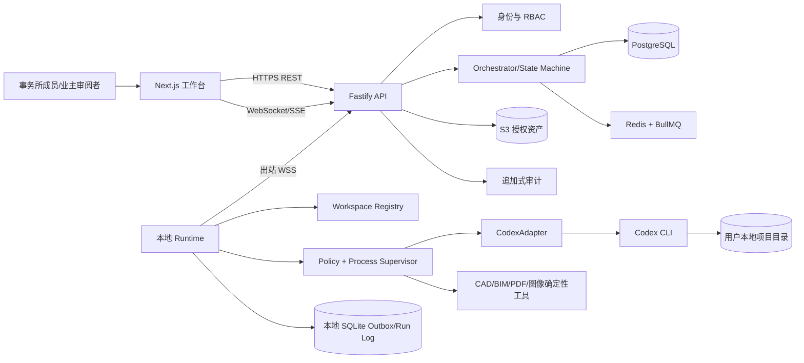
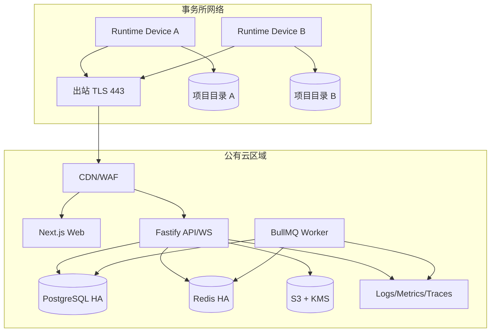
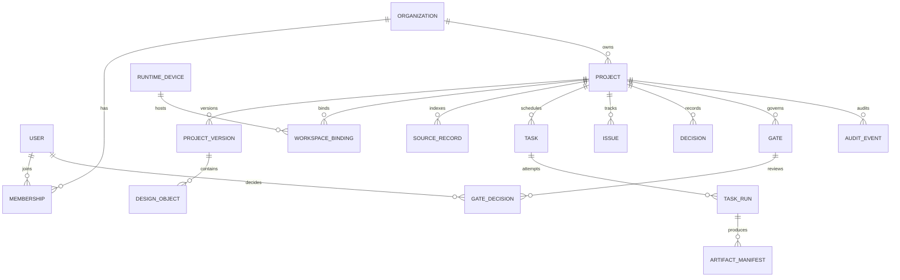
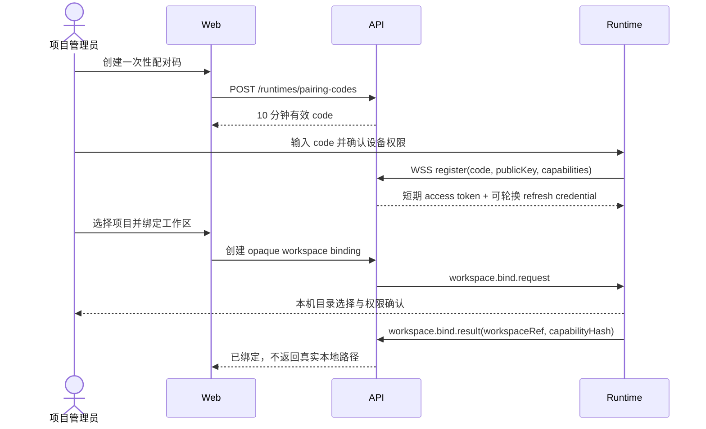
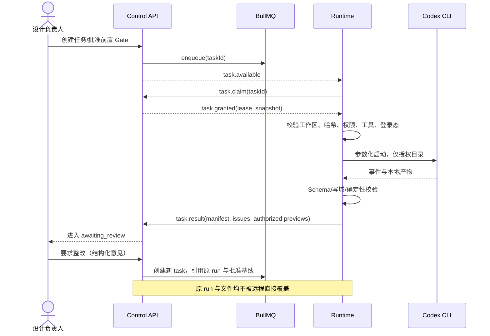

# 建筑与室内设计多 Agent 系统方案

版本：v1.0  
日期：2026-08-30  
状态：MVP 技术架构基线  
产品：筑序 ArchFlow  

适用范围：300–3000㎡住宅、民宿、小型酒店与存量改造项目  
目标读者：产品、架构、前后端、本地 Runtime、测试、安全与设计专业负责人

## 1. 系统目标

这不是一组彼此独立的建筑聊天机器人，而是一支受项目状态、专业边界和审批门禁约束的数字设计团队。

系统目标是把建筑与室内项目拆成可追溯的专业任务，让多个 Agent 在同一项目事实源上协作，产出方案、检查问题、组织审阅和组装交付；重要方向、风险接受、专业签审和最终批准仍由人负责。

系统的五项底线：

1. 只有一个权威项目状态，不允许 Agent 各自保存不同版本的事实；
2. 每个 Agent 只写自己拥有的对象和提案，不直接覆盖已批准上游成果；
3. 专业 Agent 可以提出问题和建议，但无权伪造测绘、计算、合规或签章结论；
4. 候选方案、批准方案和交付版本严格分离；
5. 任何跨 Gate 的推进都需要机器校验和明确的人类批准。

## 2. 总体组织

```text
                         人类决策委员会
                业主 / 设计负责人 / 专业负责人
                              │批准、否决、风险接受
                              ▼
                    A00 项目总控 Agent
         状态机 / 任务图 / 权限 / 版本 / Gate / 交付等级
                              │
        ┌───────────────┬─────┴────────┬───────────────┐
        ▼               ▼              ▼               ▼
   证据与需求组      设计生产组      工程接口组      审计与交付组
 A01-A05          A10-A28        A30-A37         A40-A48
        │               │              │               │
        └─────────────── Shared Project Graph ─────────┘
                 对象 / 来源 / 决策 / 问题 / 版本
                              │
                    工具与确定性计算层
       文档解析 / CAD-BIM / 几何 / 图像 / 3D / 规则 / 导出
```

## 3. 四层架构

### 3.0 技术选型基线

MVP 采用全 TypeScript monorepo，不沿用 Multica 的 Go 实现，只借鉴“云端控制、本地执行、人工审核”的运行范式。

| 层 | 固定选型 | 责任 |
|---|---|---|
| Monorepo | Node.js 22 LTS、pnpm、Turborepo、TypeScript strict | 统一构建、类型、契约与发布 |
| 远程工作台 | Next.js App Router | 项目、资料索引、任务、Gate、审核、运行状态与交付界面 |
| 控制面 API | Fastify、REST、WebSocket | 业务 API、Runtime 长连接、鉴权、幂等与审计 |
| 持久化 | PostgreSQL | 组织、项目图、版本、任务、问题、决策、Gate 与审计 |
| 队列与临时状态 | Redis、BullMQ | 调度、租约、延迟重试、通知与并发控制；不作为事实源 |
| 授权资产 | S3 兼容对象存储 | 仅保存用户明确授权同步的预览、报告和交付包 |
| 本地执行面 | Node.js 22 daemon | 工作区绑定、策略校验、Codex CLI 调度、产物扫描与断网恢复 |
| 公共契约 | Zod + 生成 JSON Schema | Web、API、Runtime 和测试共用协议，拒绝隐式字段漂移 |

首发唯一 coding agent 为 Codex CLI。Claude Code、Cursor Agent 等只保留适配接口，不进入 MVP 验收范围。远程服务不保存 coding agent 登录凭据，也不代理其模型请求。

### 3.1 部署总原则：远程控制，本地执行

参考 [Multica](https://github.com/multica-ai/multica) 的 runtime/daemon 思路，筑序不在远程服务器直接运行建筑设计 Agent，也不要求把完整项目资料上传到云端。

```text
远程工作台（Control Plane）
  项目 / 任务 / Gate / 权限 / 审核 / 通知 / 运行摘要
                         │ WebSocket：任务、心跳、状态、审核指令
                         ▼
用户电脑上的 ArchFlow Runtime / Daemon
  工作区映射 / Agent CLI 调度 / 工具权限 / 进程隔离 / 运行日志
                         │ 本地启动
                         ▼
Codex CLI（MVP）；其他 coding agent 由后续 Adapter 接入
  读取用户提供的本地资料，调用 CAD、BIM、3D、图像和文档工具
                         │ 写入本地项目目录
                         ▼
设计源文件 / 模型 / 图纸 / 报告 / 预览 / 校验结果
```

系统边界：

- **用户提供输入**：测绘、图纸、照片、模型、需求、规范和专业成果由用户主动提供或明确连接；
- **本地保管资产**：DWG、IFC、STEP、GLB、PDF、照片、视频、模型缓存和中间产物默认不上传；
- **本地运行 Agent**：远程端只选择任务、Agent 配置和技能，本地 daemon 启动用户已经安装并登录的 coding agent；
- **远程只做控制**：远程端维护任务 DAG、状态、问题、Gate、审核、权限和通知，不直接编辑建筑文件；
- **最小化同步**：默认只同步 ID、状态、摘要、哈希、缩略图、问题和批准记录；
- **显式发布**：完整成果、模型或图纸只有在用户选择交付/分享时才上传到指定位置；
- **断网可恢复**：本地运行记录可暂存，恢复连接后按 runId 幂等同步；
- **审核驱动返工**：远程审核产生结构化返工任务，由本地 Agent 在新修订中执行。

### 3.2 决策层

- **业主/使用者**：确认需求、预算、方向和使用体验；
- **设计负责人**：批准建筑与室内设计基线；
- **专业负责人**：批准本专业判断并承担相应责任；
- **项目经理**：确认计划、责任人、交付范围和版本；
- **外部专家**：对历史、结构、消防、无障碍、声学等专项复核。

### 3.3 编排层

远程 `A00 Project Orchestrator` 维护状态机、依赖图、锁、权限、预算、超时和失败恢复。它只下发结构化任务，不读取本地工作区的任意文件，也不代替专业 Agent 设计或自行批准设计。

### 3.4 专业 Agent 层

按阶段和专业拆分。每个 Agent 有固定输入、输出、工具、写入域、停止条件和上游依赖。

### 3.5 确定性工具层

所有可由确定性程序完成的工作优先交给工具，而非语言模型：

- 文件哈希、版本比较和重复检测；
- JSON Schema 校验和稳定 ID 检查；
- 面积、邻接、越界、重叠、净高和几何检查；
- IFC/STEP/GLB/DXF 解析与模型快照；
- 图像尺寸、相机、像素和视觉差异检查；
- 报告、表格、manifest 和交付包生成。

这些工具随本地 runtime 运行。远程工作台只接收工具返回的结构化结果和被用户授权的预览资产。

### 3.6 控制面与执行面责任矩阵

| 能力 | 远程工作台 | 本地 Runtime |
|---|---|---|
| 项目、阶段与 Gate | 权威状态与审核 | 只读当前任务上下文 |
| 用户原始资料 | 仅保存用户填写的索引/授权 | 保存并读取原文件 |
| Agent 配置 | 角色、技能、模型策略、权限模板 | 解析为 CLI 启动参数与本地环境 |
| 任务调度 | 排队、依赖、优先级、取消、重试 | 领取、执行、心跳、停止进程树 |
| 设计与文件修改 | 不直接执行 | coding agent 在隔离工作目录执行 |
| CAD/BIM/3D/图像工具 | 记录工具需求与审计结果 | 调用本地工具和可选云模型 |
| 运行观察 | 状态、摘要、费用、错误、批准 | 完整 stdout/stderr、工具记录和缓存 |
| 成果 | 轻量 manifest、预览、审核意见 | 完整源文件与派生资产 |
| 发布 | 用户批准后组织分享/交付 | 生成包并按授权上传 |
| 安全 | 身份、角色、任务授权、审计 | 文件系统、命令、网络、工具和凭据隔离 |

## 4. Agent 全编制

### 4.1 总控与治理组

| ID | Agent | 主要职责 | 写入域 | 否决/停止条件 |
|---|---|---|---|---|
| A00 | Project Orchestrator | 当前阶段、任务 DAG、Gate、并发、预算、版本和汇报 | ProjectState、TaskRun | 任一硬 Gate 未满足 |
| A01 | Source Registrar | 文件清点、版本、图号、格式、哈希和来源 | Source、AssetManifest | 原件不可读或版本身份不明 |
| A02 | Evidence Auditor | 权威性、尺寸、单位、北向、冲突与缺失 | EvidenceClaim、Conflict | 权威来源冲突或无校准尺度 |
| A03 | Requirements Facilitator | 用户访谈、需求、优先级和冲突问题 | Requirement、Scenario | 关键用户与用途未确认 |
| A04 | Brief Manager | 面积、房间、邻接、预算、工期和硬约束 | Brief、Constraint | Brief 内部矛盾未裁决 |
| A05 | Regulatory Router | 识别需要哪些法规与专业审查，不自动宣称合规 | ReviewRequirement | 地点/建筑属性未知或需专业签审 |

### 4.2 场地与建筑组

| ID | Agent | 主要职责 | 写入域 | 前置条件 |
|---|---|---|---|---|
| A10 | Site Analyst | 场地、朝向、高差、入口、邻里、气候、排水与风险 | SiteAnalysis | Evidence Lock |
| A11 | Precedent & Context Researcher | 地域、类型、案例、历史与材料研究 | ResearchCard | 地点与项目类型明确 |
| A12 | Program Planner | 功能分区、面积、邻接、容量和运营场景 | Program、RoomRequirement | Brief Lock |
| A13 | Architecture Designer | 体量、总图、平面、剖面、立面、屋顶和院落方案 | ArchitectureProposal | G1/G2 通过 |
| A14 | Geometry Planner | 将批准方向转为参数化 Building Schema 和灰模 | BuildingSchemaDraft | 方案候选完整 |
| A15 | Circulation Analyst | 人流、物流、洁污、无障碍意向与疏散提示 | Route、CirculationIssue | 空间候选形成 |
| A16 | Envelope & Climate Agent | 采光、遮阳、通风、屋面、围护和雨水策略 | EnvelopeProposal | 场地与体量明确 |
| A17 | Heritage/Renovation Agent | 保留、拆除、新旧关系、可逆介入和证据等级 | RetentionPlan | 存量/保护项目启用 |

### 4.3 室内、景观与运营组

| ID | Agent | 主要职责 | 写入域 | 前置条件 |
|---|---|---|---|---|
| A20 | Interior Lead | 空间体验、房间标准、室内系统与设计主线 | InteriorProposal | Architecture Lock |
| A21 | Room Data Agent | 每个房间的活动、容量、家具、材料、设备和维护 | RoomDataSheet | 房间/开口锁定 |
| A22 | FF&E Agent | 家具、洁具、设备、软装与产品状态 | FF&EItem | 房间标准形成 |
| A23 | Material Agent | 材料 ID、位置、性能、色彩、样板与替代项 | Material、Finish | 建筑/室内方向形成 |
| A24 | Lighting Agent | 日光意图、场景、灯具、控制与眩光提示 | LightingScene、Luminaire | 房间与材料形成 |
| A25 | Landscape Agent | 场地流线、植物、铺装、雨水、边界和维护 | LandscapeProposal | 总图锁定 |
| A26 | Operations Agent | 客流、后勤、餐饮、布草、垃圾、保洁和峰值运营 | OperationsScenario | 经营性项目启用 |
| A27 | Signage & Wayfinding Agent | 导视、标识、信息层级和路径 | SignageSystem | 路线稳定 |
| A28 | Accessibility Experience Agent | 适老、行动、感知和可达体验检查 | AccessibilityIssue | 空间和室内形成 |

### 4.4 工程接口组

这些 Agent 负责方案级接口审查和专业任务书，不代替注册工程师计算或签章。

| ID | Agent | 主要职责 | 可输出 | 不可输出 |
|---|---|---|---|---|
| A30 | Structure Interface Agent | 柱网、跨度、悬挑、洞口、基础/挡土风险 | 结构问题、顾问任务书 | 结构安全结论 |
| A31 | MEP Interface Agent | 机房、竖井、设备、吊顶、检修和综合接口 | 机电空间需求、冲突 | 施工级机电设计 |
| A32 | Water & Drainage Agent | 湿区叠合、给排水、屋面/场地排水和化粪池接口 | 排水逻辑、问题清单 | 水力计算与报审结论 |
| A33 | Fire & Life Safety Agent | 防火分区、疏散、消防车道和专业审查需求 | 风险提示、审查任务书 | 消防合规批准 |
| A34 | Acoustic Agent | 客房、设备、餐饮、活动和隔声接口 | 声学指标意向、问题 | 正式声学计算 |
| A35 | Kitchen & Service Agent | 厨房流程、设备、排烟、补风、清洁与后勤 | 厨房接口与设备需求 | 厂家深化和卫生许可 |
| A36 | Cost Agent | 面积、系统、材料、风险和 VE 决策状态 | 方案级成本区间、偏差 | 精确清单计价承诺 |
| A37 | Maintainability Agent | 检修、清洁、更换、耐候和全生命周期提示 | 维护路径与风险 | 设备质保结论 |

### 4.5 视觉、审计与交付组

| ID | Agent | 主要职责 | 核心约束 |
|---|---|---|---|
| A40 | Camera & Scene Agent | 固定相机、世界坐标、图层、构件与场景锁 | 相机和几何先于生成 |
| A41 | Visualization Director | 视角意图、材质、光影、人物和场景提示 | 不得改锁定设计 |
| A42 | Render Producer | 生成候选、局部返工和版本登记 | 候选不得自动晋升 |
| A43 | Visual Consistency Auditor | 多视角、日夜、几何、开口、材料和家具核对 | Major 漂移直接拒收 |
| A44 | Model QA Agent | IFC/STEP/GLB 单位、包围盒、对象、资源和交互检查 | 构建成功不等于画面通过 |
| A45 | Cross-discipline Coordinator | 汇总接口矩阵、合并重复问题、追踪关闭证据 | 不替专业负责人关闭问题 |
| A46 | Independent Critic | 从范围、证据、设计、生产四个视角反向找错 | 与生产 Agent 隔离上下文偏见 |
| A47 | Delivery Assembler | 成果目录、报告、图表、manifest、排除项和等级 | 不得自动提高交付等级 |
| A48 | Release Auditor | 最终版本、链接、权限、哈希、敏感信息和签审 | Blocker/Major 未清零不发布 |

视觉生产在控制面中作为正式任务链实现，而不是交付后的静态图库：远程工作台创建 `type=image-generation` 的结构化任务，本地 Runtime 经 Codex Adapter 调用 `$imagegen` 并将原始候选保留在授权工作区；人工审核通过后，用户再显式登记可同步预览。控制面只接收稳定 ID、SHA-256、脱敏元数据和 `authorizedPreviewUrl`，项目聚合以 `visuals` 返回授权结果。G7 Visual Lock 同时要求至少一个已完成的 ImageGen 任务和至少一个授权预览；任一条件缺失都返回结构化阻断错误。G8 Delivery Gate 与 manifest 只消费这条批准链上的成果，项目归档后禁止继续改变交付基线。

## 5. Agent 不等于模型调用

一个 Agent 是完整执行单元，应包含：

```text
Agent = Role Policy
      + Input Contract
      + Tool Allowlist
      + Read/Write Scope
      + Output Schema
      + Validation Rules
      + Stop Conditions
      + Escalation Policy
      + Run Record
```

部分 Agent 可以完全确定性运行，例如版本登记、几何校验和交付 manifest；部分 Agent 使用语言或视觉模型辅助判断；高风险 Agent 必须输出问题和证据，不能自行下最终结论。

## 6. 权威状态与共享项目图

### 6.1 唯一事实源

所有 Agent 通过本地 runtime 获得一个签名的任务上下文快照。远程 `Project Graph API` 是流程、决策和审核的权威状态；本地项目目录是图纸、模型和详细设计资产的权威来源。两者通过稳定 ID、版本、哈希和 manifest 对齐，不把聊天或临时提示词当作事实源。

项目图至少包含：

- `ProjectState`：阶段、版本、交付等级、当前 Gate；
- `Source` 与 `EvidenceClaim`：来源、权威、页码/图号、知识状态；
- `Brief` 与 `Constraint`：需求、硬约束和批准状态；
- `DesignObject`：场地、建筑、房间、开口、材料、设备、相机等；
- `Decision`：候选、理由、批准人和下游影响；
- `Issue`：严重度、责任人、状态和关闭证据；
- `Deliverable`：来源对象、版本、等级、哈希和签审。

### 6.2 写权规则

1. Agent 只能向自己的 `proposal namespace` 写候选；
2. 已批准对象只允许总控创建新修订，不能原地覆盖；
3. 专业 Agent 可写本专业问题，不能关闭其他专业问题；
4. 只有 Gate 审批动作能把候选合并进 approved baseline；
5. 每次合并自动生成 diff 和下游影响列表；
6. 交付 Agent 对设计对象只读。

远程端无权直接写入本地文件。它只能创建任务、审核结论和结构化 patch 意图；实际 patch 必须由本地 Agent 在明确工作目录中执行、校验并生成 diff。

### 6.3 锁类型

- **Source Lock**：权威来源和版本；
- **Brief Lock**：需求、面积、预算和硬约束；
- **Geometry Lock**：边界、坐标、层高、开口、楼梯和屋顶；
- **Identity Lock**：材料、家具、设备和可见构件身份；
- **Camera Lock**：相机坐标、焦距、裁切和视图意图；
- **Approval Lock**：谁在何时批准何版本；
- **Delivery Lock**：交付等级、排除项和外部签审。

## 7. 标准交接协议

任务交接通过远程队列和本地 daemon 完成。远程请求不得内嵌完整 DWG、IFC、照片或其他敏感资料，只传递本地资源引用和预期哈希。

### 7.1 Request

```json
{
  "requestId": "REQ-20260830-0012",
  "projectId": "PRJ-001",
  "projectVersion": "v03",
  "agentId": "A20",
  "taskType": "develop-interior-option",
  "contractVersion": "1.0.0",
  "inputRefs": ["ARCH-LOCK-v03", "BRIEF-LOCK-v02"],
  "localWorkspaceRef": "workspace://anji-homestay",
  "requiredLocalAssets": [
    {"id": "SRC-014", "relativePath": "inputs/survey/site-v02.dwg", "sha256": "..."}
  ],
  "allowedWritePaths": ["/proposals/interior/A20/*"],
  "hardConstraints": ["no-opening-change", "wet-zones-locked"],
  "timeoutMs": 120000,
  "requiredOutputSchema": "InteriorProposal.v1"
}
```

本地 daemon 在启动 Agent 前必须验证：工作区映射存在、文件哈希匹配、用户授权有效、CLI 可执行且已登录、所需工具可用。验证失败时返回缺失项，不从互联网寻找替代资料。

### 7.2 Response

```json
{
  "ok": true,
  "runId": "RUN-A20-0041",
  "baseVersion": "v03",
  "outputRefs": ["INT-PROP-03A"],
  "claims": [
    {"id": "CLM-201", "status": "inferred", "sourceIds": ["BRIEF-17"]}
  ],
  "proposedChanges": [
    {"path": "/rooms/R12/furniture", "operation": "replace", "reason": "..."}
  ],
  "issuesRaised": ["ISS-MEP-014"],
  "assumptions": ["ASM-009"],
  "validation": {"schema": "passed", "hardConstraints": "passed"},
  "recommendedNext": ["A31", "A45"]
}
```

### 7.3 标准错误码

- `invalid_input`：输入格式错误；
- `stale_base_version`：任务基线已过期；
- `missing_evidence`：缺少必要证据；
- `authority_conflict`：权威来源冲突；
- `constraint_violation`：违反硬约束；
- `schema_validation_failed`：输出不符合契约；
- `write_scope_violation`：越权写入；
- `professional_review_required`：必须转人工/专业人员；
- `timeout`、`provider_error`、`retry_exhausted`。

输出修复最多两轮；仍不通过时失败关闭，不能把半成品合并到项目状态。

## 8. 任务状态机

```text
created
  → ready
  → running
  → validating
  → awaiting_review
  → accepted ──→ merged
             └→ rejected

running/validating
  → blocked_missing_input
  → blocked_conflict
  → failed_retryable
  → failed_terminal
  → superseded
```

任务只有在 `merged` 后才成为后续 Agent 的权威输入。`accepted` 表示内容通过审阅，`merged` 表示已进入新的批准版本，两者不可混写。

## 9. 项目阶段状态机

| 阶段 | 主 Agent | 可并行 Agent | Gate 审批人 | 产物 |
|---|---|---|---|---|
| S0 项目登记 | A00、A01 | A03、A05 | 项目经理 | 项目状态、资料清单 |
| S1 证据审计 | A02 | A10、A11 的非几何研究 | 设计负责人 | Evidence Lock |
| S2 Brief | A03、A04 | A12、A26 | 业主+设计负责人 | Brief Lock |
| S3 概念方案 | A13 | A10、A12、A15、A16、A25、A26 | 业主+设计负责人 | Concept Lock |
| S4 建筑基线 | A14、A13 | A15、A16、A30-A35 | 建筑负责人 | Architecture Lock |
| S5 室内深化 | A20 | A21-A28、A31-A37 | 室内+建筑负责人 | Design/Detail Lock |
| S6 协调审查 | A45 | A30-A37、A46 | 各专业负责人 | Coordination Gate |
| S7 视觉生产 | A40-A42 | 代表机位通过后可多机位并行 | 设计负责人 | Visual Lock |
| S8 交付发布 | A47、A48 | 无跨版本并发 | 项目经理+责任人 | Delivery Lock |

## 10. 并行与串行规则

### 10.1 可以并行

- 资料登记、非几何背景研究和需求访谈；
- 同一批准 Brief 下的建筑 A/B/C 候选；
- 已锁定建筑下的房间卡、材料、灯光、FF&E 和运营分析；
- 同一模型下的结构、机电、排水、消防、声学和成本接口审查；
- 代表机位批准后的其他固定机位视觉生成；
- 最终包中的不同表格和报告生成。

### 10.2 必须串行

- Evidence Lock → 正式几何；
- Brief Lock → 方案比选；
- Architecture Lock → 全屋室内深化；
- Geometry/Material/Camera Lock → 正式视觉；
- 专业问题关闭 → 交付等级升级；
- 最终版本冻结 → manifest 与发布审计。

### 10.3 并行合并规则

并行任务不能直接互相覆盖。每个任务基于同一 `baseVersion` 产生 patch；总控按以下顺序合并：

1. Schema 与写权校验；
2. 检查基线是否过期；
3. 检测路径冲突和语义冲突；
4. 无冲突的 patch 自动进入候选集；
5. 冲突项交给 A45 汇总并请求责任人裁决；
6. Gate 批准后创建新版本；
7. 触发下游失效与重算任务。

## 11. 完整住宅/民宿执行剧本

### Sprint 0：启动

1. A00 创建项目、交付等级和任务图；
2. A01 只读登记所有资料；
3. A02 输出证据、冲突和补测清单；
4. A03/A04 组织需求与 Brief；
5. 人工批准 G1 Evidence 和 G2 Brief。

### Sprint 1：概念

1. A10/A11/A12/A26 并行形成场地、地域、功能和运营约束；
2. A13 生成三套可比较方案，不生成大量效果图；
3. A14 为每套方案生成可校验灰模；
4. A15/A16/A25/A30/A36 做快速风险筛查；
5. A46 独立批评范围、证据与可实施性；
6. 人工选择方案并批准 Concept Lock。

### Sprint 2：建筑基线

1. A13/A14 完成平面、立面、剖面、屋顶、开口和楼梯；
2. A30-A35 并行检查专业空间接口；
3. A45 合并问题、分配责任、追踪关闭；
4. A46 做第二轮反向审计；
5. 建筑负责人批准 Architecture Lock。

### Sprint 3：室内与运营

1. A20 建立室内主线和代表房间；
2. A21-A28 并行生成房间卡、家具、材料、灯光、景观、运营和导视；
3. A31-A37 检查设备、吊顶、湿区、厨房、声学、成本和维护；
4. 先批准一个代表客房/公共空间，再复制标准；
5. 人工批准 Detail Lock。

### Sprint 4：视觉与交付

1. A40 固定模型、图层和相机；
2. A41 编制统一身份锚点和视图意图；
3. A42 先生成一个代表机位；
4. A43/A44 实际检查画面、几何和交互；
5. 代表机位通过后批量并行其他机位；
6. A45/A46 完成跨专业与独立终审；
7. A47 组装交付，A48 执行发布审计；
8. 人工批准 Delivery Lock。

## 12. Critic 与生产 Agent 隔离

审计不能只让生产 Agent 自检。每个关键阶段至少有以下独立 Critic：

| Critic | 检查问题 |
|---|---|
| Scope Critic | 是否漏项、缩小范围或用空模板冒充完成 |
| Evidence Critic | 是否证据越级、来源冲突或假设冒充事实 |
| Design Critic | 是否空间、运营、材料和体验逻辑不成立 |
| Coordination Critic | 是否存在跨专业接口、维护或安全风险 |
| Production Critic | 是否契约、ID、版本、图像和交付流程不可执行 |

Critic 只提问题和证据，不直接修改主产物。生产 Agent 修正后，Critic 按稳定问题 ID 复审；Blocker 和 Major 必须有关闭证据。

## 13. 人在回路与否决权

### 13.1 必须人工批准

- 项目用途、交付等级和风险边界；
- Brief Lock；
- 方案方向选择；
- 建筑、室内和材料基线；
- 预算重大取舍；
- 任何生命安全风险接受；
- 专业顾问签审；
- Visual Lock 和 Delivery Lock。

### 13.2 Agent 可自动执行

- 文件登记、格式解析、版本比较；
- Schema、ID、面积和基础几何检查；
- 已批准参数内的派生表格和视图；
- 无冲突、白名单内、可逆的小范围修复；
- 交付目录、manifest 和一致性报告。

### 13.3 自动修改白名单

系统只能在明确批准的路径上自动修改，例如：

- 修复缺失元数据和格式；
- 在不改变总面积和房间数量时调整非关键显示字段；
- 返工效果图中的天空、人物密度或曝光；
- 不改变几何的材料贴图修复。

体量、层数、房间数、楼梯、开口、结构、湿区、成本上限和法定条件默认不在白名单。

## 14. 变更影响与失效传播

每次批准对象变化后，A00 从依赖图计算影响：

```text
开口位置变化
  → 受影响房间卡
  → 固定家具/窗帘/灯光
  → 立面与节能接口
  → 机电点位
  → 固定相机视觉
  → 材料表和成本状态
  → 交付图册
```

受影响成果状态自动从 `approved` 变成 `stale`，但历史版本不删除。只有重新验证后才能恢复批准状态。

## 15. Agent 运行记录

每次运行追加保存：

- requestId、runId、agentId、模型/工具版本；
- projectId、baseVersion、contractVersion；
- 输入引用，不重复保存敏感原件；
- 输出引用、diff、问题和假设；
- 开始/结束时间、耗时、费用与 token；
- 校验结果、重试、失败原因；
- 人工批准、拒绝或覆盖；
- 敏感字段自动脱敏。

完整运行记录首先保存在本地，只追加不覆盖。远程默认同步状态、耗时、Agent/工具版本、错误分类、输出 manifest 和经脱敏的摘要；命令全文、文件内容和敏感路径是否同步由项目策略决定。

### 15.1 本地 Runtime 核心模块

| 模块 | 职责 |
|---|---|
| Connection Manager | WebSocket 长连接、心跳、重连和任务通知 |
| Workspace Registry | 将远程项目绑定到用户选择的本地目录 |
| Task Claimer | 原子领取任务，防止两个 runtime 重复执行 |
| Agent Adapter | 通过稳定接口启动 coding agent；MVP 仅实现 CodexAdapter |
| Context Builder | 生成本地任务提示、AGENTS、Skills 和资源引用 |
| Policy Sandbox | 限制工作目录、命令、网络、工具和敏感环境变量 |
| Process Supervisor | 超时、取消、进程树终止、重试和断点恢复 |
| Artifact Scanner | 发现新增/修改文件，生成 diff、哈希和 manifest |
| Local Preview Service | 在本地提供模型、图纸、图片和报告预览 |
| Sync Broker | 只同步被策略允许的摘要、预览和成果 |

### 15.2 远程任务生命周期

```text
用户在工作台创建/批准任务
  → 控制面写入 queued
  → WebSocket 通知已绑定 runtime
  → daemon 原子 claim
  → 校验本地工作区和必要资料
  → 启动 coding agent
  → 心跳同步 running/progress/blocker
  → 本地校验产物
  → 同步 manifest + 摘要 + 授权预览
  → 任务进入 in_review
  → 人工批准 / 请求修改 / 拒绝
  → 请求修改生成新 task，不覆盖原 run
```

## 16. 模型路由与成本治理

| 任务类型 | 默认执行 | 升级条件 |
|---|---|---|
| 文件、Schema、几何、版本 | 确定性程序 | 工具无法解析 |
| 分类、摘要、补问 | 低成本语言模型 | 来源冲突复杂 |
| 方案、研究、协调 | 强推理模型 + 工具 | 高风险或多专业冲突 |
| 图像理解与视觉审计 | 视觉模型 + 像素/几何检查 | 人工视觉争议 |
| 最终风险和专业结论 | 人类专业人员 | 永不自动替代 |

每个阶段设置任务数、时间、模型调用和图像候选上限。达到上限时停止并汇报，不进行无目标的重复生成。

## 17. 失败恢复

| 失败 | 系统行为 |
|---|---|
| 非法 JSON/缺字段 | 最多两轮机器可读修复 |
| 基线版本过期 | 丢弃自动合并，基于新版本重新运行 |
| Agent 越权写入 | 拒绝 patch、记录安全事件 |
| 权威来源冲突 | 冻结相关对象，要求人工裁决 |
| 专业 Agent 互相矛盾 | A45 汇总影响，由责任人决定 |
| 模型/工具超时 | 有限重试，随后回退或人工接管 |
| 视觉漂移 | 只返工失败视图或失败对象 |
| 改进分数下降 | 拒绝候选并回退上一批准版本 |
| Gate 未通过 | 降级交付，不删除已有工作 |

## 18. 评测体系

### 18.1 单 Agent 测试

- 契约与 Schema 测试；
- 缺失、冲突、恶意和过期输入测试；
- 稳定 ID、单位、面积和写权测试；
- 停止条件和专业边界测试；
- 同输入重复运行的稳定性测试。

### 18.2 多 Agent 集成测试

- 并行 patch 冲突与合并；
- 上游变更后的失效传播；
- Critic 问题关闭与复审；
- 建筑、室内、材料和视觉跨域一致性；
- 版本回退和断点续跑；
- 角色权限与敏感信息隔离。

### 18.3 项目级验收

- 所有正式结论可回链来源或批准；
- 重大变更影响召回率不低于 95%；
- Blocker/Major 无证据关闭数为 0；
- 批准视觉的层数、屋顶、主要开口和固定家具漂移为 0；
- 交付等级、排除项和专业复核完整率 100%；
- 人工拒绝原因能回流为测试样例。

## 19. 部署形态

### 19.1 MVP：单体编排服务

- 一个 Web 应用；
- 一个 Project Graph/关系数据库；
- 一个任务队列和 Orchestrator；
- 本地 daemon 作为执行 worker，驱动用户已安装的 coding agent CLI；
- S3 兼容对象存储只保存用户授权同步的预览、报告和交付包；
- 审计日志与运行记录分开保存。

对象存储只保存用户显式上传或批准同步的资产。首版不需要为每个 Agent 建微服务，远程端也不直接配置模型密钥。

### 19.1.1 MVP 部署拓扑

```text
浏览器远程工作台
        │ HTTPS / WebSocket
        ▼
API + Task Queue + Project State + Review Log
        ▲
        │ 出站 WebSocket（无需开放用户电脑入站端口）
        ▼
ArchFlow Runtime（用户电脑）
        ├── Codex CLI
        ├── AgentAdapter 扩展位（MVP 不启用）
        ├── FreeCAD / Blender / IFC / PDF 工具
        ├── 本地项目目录
        └── 本地预览与运行缓存
```

Runtime 主动连接远程服务，远程服务不能任意浏览用户磁盘；每个任务只能访问绑定工作区和批准工具。

### 19.2 团队版

- 多组织、角色与项目隔离；
- 企业模板、材料库和标准；
- 可替换模型提供商；
- 私有部署、审计导出与数据保留策略；
- 与 CAD/BIM、云盘和项目管理系统连接。

### 19.3 扩展原则

只有满足以下条件才把 Agent 独立成共享服务：

1. 至少两个真实项目类型持续调用；
2. 输入输出语义稳定；
3. Owner、SLA、版本和退出机制明确；
4. 独立服务不会阻塞现有项目闭环。

## 20. MVP Agent 子集

完整编制不等于首版全部开发。MVP 建议先实现 12 个 Agent：

1. A00 Project Orchestrator；
2. A01 Source Registrar；
3. A02 Evidence Auditor；
4. A04 Brief Manager；
5. A12 Program Planner；
6. A13 Architecture Designer；
7. A14 Geometry Planner；
8. A20 Interior Lead；
9. A21 Room Data Agent；
10. A43 Visual Consistency Auditor；
11. A45 Cross-discipline Coordinator；
12. A47 Delivery Assembler。

结构、机电、消防等专业先作为规则检查器和人工顾问任务书，不在 MVP 中伪装成全自动工程师。

## 21. MVP 里程碑

### M0 契约与项目图

- Project State、Agent Request/Response、Issue、Decision、Lock Schema；
- 写权、版本、运行记录和错误码；
- Runtime 注册、工作区绑定、WebSocket、claim/heartbeat/cancel 协议；
- 住宅与民宿两套测试夹具。

### M1 资料到 Brief

- A00/A01/A02/A04；
- Evidence Lock、Brief Lock 和补问流程；
- 人工审批界面。

### M2 Brief 到建筑基线

- A12/A13/A14；
- 三方案对比、参数灰模、基础几何检查；
- Concept/Architecture Lock。

### M3 建筑到室内

- A20/A21；
- Room Data Sheet、材料/家具引用和变更失效；
- 代表房间批准流程。

### M4 审计与交付

- A43/A45/A47；
- 多视角审计、问题闭环、分级交付和 manifest；
- 住宅与民宿端到端回归测试。

## 22. 成功判定

这套多 Agent 系统成功的标志不是 Agent 数量多，而是：

- 两个不同类型真实项目可以复用同一项目图和交接协议；
- 专业 Agent 并行后不会产生无法解释的版本冲突；
- 设计负责人能准确知道当前事实、假设、风险和待批准事项；
- 建筑改动能可靠触发室内、专业、视觉和交付重审；
- AI 生成的漂亮图片不能绕过几何、证据和人工批准；
- 最终交付明确说明能用于什么、不能用于什么。

## 23. 工程架构基线

### 23.1 Monorepo 边界

```text
apps/
  web/                 Next.js 远程工作台
  api/                 Fastify REST + WebSocket 控制面
  runtime/             Node.js 本地 daemon 与系统服务入口
packages/
  contracts/           Zod、JSON Schema、协议版本与错误码
  db/                  PostgreSQL schema、迁移与 repository
  auth/                会话、RBAC、runtime token 与租户上下文
  orchestration/       状态机、DAG、Gate、影响传播与队列策略
  agent-adapters/      AgentAdapter 与 CodexAdapter
  observability/       日志、指标、trace 与敏感字段过滤
  test-fixtures/       住宅、民宿及恶意输入固定样例
```

边界规则：`apps/*` 只能通过包的公开入口依赖 `packages/*`；`contracts` 不依赖数据库或框架；业务状态变更必须经过 `orchestration`；Web 不直接操作数据库；Runtime 不共享控制面数据库连接。

### 23.2 组件图



### 23.3 关键架构决策

| ADR | 决策 | 理由与后果 |
|---|---|---|
| ADR-001 | 控制面与资产面分离 | 云端可协作审核，原始设计资产仍留本地；预览必须显式授权 |
| ADR-002 | PostgreSQL 是唯一远程事实源 | Redis 丢失后可重建队列；避免队列状态冒充业务状态 |
| ADR-003 | 任务采用租约而非永久归属 | Runtime 失联后可恢复；同一 task 只能有一个有效 lease |
| ADR-004 | 审核不直接修改文件 | 每条整改意见生成新任务和新 run，保留原始证据链 |
| ADR-005 | 契约先行 | 所有跨进程消息由 Zod 校验并生成 JSON Schema，支持兼容性测试 |
| ADR-006 | MVP 只支持 Codex | 减少认证、能力差异和故障面；其他 CLI 通过接口扩展 |
| ADR-007 | 模块化单体控制面 | MVP 降低运维复杂度；队列 worker 可独立扩容但共享领域模型 |

## 24. 部署架构

### 24.1 公有云多租户部署



生产环境至少分 `dev/staging/prod` 三套独立账号或项目。数据库迁移使用向前兼容的 expand/migrate/contract 流程；API 与 Runtime 至少兼容当前及前一个协议次版本。Runtime 只需出站 443，不开放用户电脑入站端口。

### 24.2 本地 Runtime 生命周期

MVP 通过 npm 包安装，提供 `archflow-runtime install/start/status/stop/uninstall`。安装命令在 macOS 注册 LaunchAgent、Windows 注册用户级 Service、Linux 注册 systemd user service；安装服务前必须展示本地目录、命令与网络权限。

Runtime 本地数据目录保存：设备身份、加密 refresh credential、工作区映射、本地 SQLite outbox、任务临时目录、运行日志和缓存。卸载默认保留项目文件，仅删除程序与运行缓存；清除凭据和历史日志需用户显式确认。

## 25. 核心数据模型

### 25.1 ER 图



### 25.2 实体与关键约束

| 实体 | 关键字段 | 不变量 |
|---|---|---|
| Organization | `id, name, plan, dataRegion` | 租户隔离根；所有业务查询必须携带 `organizationId` |
| Project | `id, organizationId, type, phase, currentVersionId` | 当前版本只能指向同项目已批准版本 |
| ProjectVersion | `id, projectId, parentId, status, contentHash` | `candidate/approved/stale/superseded`；批准版本不可原地修改 |
| SourceRecord | `id, localRef, sha256, mediaType, authority, status` | 不保存绝对本地路径；哈希变化生成新版本 |
| RuntimeDevice | `id, organizationId, publicKey, status, lastSeenAt` | 设备 credential 可独立吊销 |
| WorkspaceBinding | `projectId, runtimeId, workspaceRef, permissionProfile` | 远程只保存 opaque ref，不保存真实目录 |
| Task | `id, type, agentId, baseVersionId, state, priority` | `idempotencyKey` 在组织内唯一 |
| TaskRun | `id, taskId, runtimeId, leaseId, attempt, state` | 同一 task 同时最多一个有效 lease |
| Issue | `id, severity, ownerRole, state, evidenceRefs` | Blocker/Major 无证据不能关闭 |
| GateDecision | `gateId, versionId, decision, actorId, rationale` | actor 必须拥有对应审批权限；记录不可更新，只能追加 |
| ArtifactManifest | `id, runId, entries, policy, hash` | 资产上传和 manifest 登记分离；默认 `local_only` |
| AuditEvent | `id, actor, action, target, beforeHash, afterHash, occurredAt` | 追加式、不可业务删除、敏感字段脱敏 |

所有业务主键使用 UUIDv7；外部显示编号另设不可复用的短编号。时间统一保存 UTC ISO 8601，面积与长度同时保存数值和单位，金额保存最小货币单位与币种。

## 26. 公共契约与版本策略

### 26.1 契约目录

`packages/contracts` 必须导出以下 Zod Schema、推导的 TypeScript 类型和生成的 JSON Schema：

| 契约 | 用途 | 必需字段 |
|---|---|---|
| `ProjectSnapshot` | 单次任务的不可变远程上下文 | project/version/gates/refs/constraints/snapshotHash |
| `TaskRequest` | 控制面下发执行请求 | taskId/idempotencyKey/agent/baseVersion/requiredAssets/writePolicy/timeout |
| `TaskResult` | Runtime 回传终态 | runId/status/baseVersion/manifest/issues/validation/error |
| `ArtifactManifest` | 本地产物清单 | entries(pathRef/hash/mediaType/size/syncPolicy)/manifestHash |
| `Issue` | 结构化问题 | severity/domain/title/evidence/owner/state/resolution |
| `GateDecision` | 人工审批 | gate/version/decision/rationale/conditions/actor/timestamp |
| `RuntimeHeartbeat` | 设备与租约保活 | runtimeId/protocolVersion/activeRuns/resources/lastEventSeq |
| `ProtocolError` | 统一错误 | code/message/retryable/correlationId/details |

`TaskRequest.writePolicy` 只允许相对路径 glob、最大写入字节数、允许的文件类型和是否允许联网；禁止由控制面传递任意 shell 字符串。任务提示、工具参数和执行程序是分离字段，CodexAdapter 不通过 shell 拼接用户内容。

### 26.2 AgentAdapter

```ts
export interface AgentAdapter {
  readonly id: string;
  probe(): Promise<AgentCapability>;
  authenticate(): Promise<AgentAuthState>;
  prepare(input: AdapterPrepareInput): Promise<PreparedRun>;
  start(run: PreparedRun, events: AgentEventSink): Promise<AgentProcess>;
  cancel(process: AgentProcess, reason: CancelReason): Promise<void>;
  collect(process: AgentProcess): Promise<AdapterResult>;
}
```

`CodexAdapter` 必须检测 CLI 版本与登录态，通过参数数组启动进程，清理非允许环境变量，将 stdout/stderr 转为结构化事件，并在取消时终止整个进程树。Adapter 不负责批准、合并或上传资产。

### 26.3 兼容规则

- 协议使用 `major.minor`；major 不同拒绝配对，minor 落后一版允许降级；
- 新增可选字段属于向后兼容，删除/改义/收紧枚举属于破坏性变更；
- 未知字段保留在传输层但不进入领域写入；未知事件返回 `unsupported_event`；
- JSON Schema 发布到版本化目录并在 CI 做 breaking-change diff；
- 所有写请求必须带 `Idempotency-Key`，结果按组织、操作和 key 去重。

### 26.4 标准错误码

除第 7.3 节的专业错误外，协议增加：`unauthorized`、`forbidden`、`tenant_mismatch`、`protocol_incompatible`、`runtime_offline`、`lease_lost`、`workspace_unbound`、`asset_hash_mismatch`、`agent_not_authenticated`、`tool_unavailable`、`upload_not_authorized`、`rate_limited`。每个错误都必须声明是否可重试；认证、越权、基线过期和写入越界不得自动重试。

## 27. 控制面接口目录

### 27.1 REST API

统一前缀 `/api/v1`，以 OIDC 会话或 service token 鉴权；所有响应携带 `requestId`。

| 方法与路径 | 用途 | 最低权限 |
|---|---|---|
| `POST /projects` | 创建项目 | org_owner/project_manager |
| `GET /projects/:id` | 项目总览与当前 Gate | project_view |
| `POST /projects/:id/sources` | 登记用户本地资料索引 | source_manage |
| `POST /projects/:id/snapshots` | 冻结任务上下文 | task_create |
| `GET /projects/:id/versions` | 查询版本与失效状态 | project_view |
| `POST /projects/:id/tasks` | 基于 snapshot 创建任务 | task_create |
| `POST /tasks/:id/cancel` | 请求取消 | task_cancel |
| `GET /tasks/:id/runs` | 查看尝试、摘要和 manifest | run_view |
| `GET/POST /projects/:id/issues` | 查询/创建问题 | issue_view/issue_create |
| `POST /issues/:id/resolve` | 提交关闭证据 | issue_resolve_own |
| `GET /projects/:id/gates` | Gate 列表与前置条件 | project_view |
| `POST /gates/:id/decisions` | 批准、驳回或附条件批准 | gate_decide |
| `POST /reviews/:id/revisions` | 将审核意见生成本地修订任务 | task_create |
| `POST /artifacts/:id/upload-authorizations` | 授权单个资产上传 | artifact_publish |
| `GET /projects/:id/deliveries` | 查询交付等级和包 | delivery_view |
| `POST /projects/:id/deliveries` | 生成/发布交付包 | delivery_publish |
| `POST /runtimes/pairing-codes` | 创建设备一次性配对码 | runtime_manage |
| `DELETE /runtimes/:id` | 吊销 Runtime | runtime_manage |

列表接口统一使用游标分页；写接口支持乐观并发 `If-Match`；状态冲突返回 `409 stale_base_version`。对象存储上传使用短期、单对象、限定大小和媒体类型的签名 URL。

### 27.2 Runtime WebSocket

端点 `/runtime/v1/connect`，Runtime 主动建立 WSS。每个 envelope 为 `{type, protocolVersion, runtimeId, eventId, sentAt, payload}`，服务端按 `eventId` 幂等处理并回传 `ack`。

| 方向 | 事件 | 含义 |
|---|---|---|
| Runtime → Server | `runtime.register` | 声明设备、公钥、版本和能力 |
| 双向 | `runtime.heartbeat` / `ack` | 设备、资源、活动租约与最后事件序号 |
| Server → Runtime | `task.available` | 仅通知，不代表已领取 |
| Runtime → Server | `task.claim` | 使用 taskId 原子申请租约 |
| Server → Runtime | `task.granted/denied` | 返回 leaseId、到期时间和快照 |
| Runtime → Server | `task.started/progress/blocked` | 结构化运行进度，不上传原始文件内容 |
| Server → Runtime | `task.cancel` | 带原因和截止时间的取消请求 |
| Runtime → Server | `task.cancelled/result` | 取消确认或幂等终态结果 |
| Runtime → Server | `runtime.reconnect` | 携带未确认事件和活动 run 恢复连接 |
| Server → Runtime | `lease.revoked` | 基线失效、用户撤销或安全事件 |

心跳默认 15 秒，45 秒无心跳标记 `degraded`，90 秒标记 `offline` 并停止续租。默认租约 60 秒、随心跳续期；失去租约后 Runtime 必须停止产生可合并结果，但可保留本地诊断包。

## 28. 关键时序

### 28.1 配对与工作区绑定



### 28.2 任务执行与审核返工



## 29. 状态机与事务规则

### 29.1 Task 与 Run 分离

`Task` 表达业务意图，可以有多个 `TaskRun` 尝试。第 8 节的业务状态由控制面维护；运行尝试使用：

```text
pending → leased → preflight → executing → validating → uploaded → completed
             │          │           │           │
             └──────────┴───────────┴───────────→ cancelled
                        └───────────→ blocked
                                    → failed_retryable → pending（新 attempt）
                                    → failed_terminal
```

`claim`、lease 写入与任务状态转换必须在一个数据库事务中完成；BullMQ job 只携带 `taskId`。终态结果以 `(runId, resultHash)` 幂等：相同哈希返回原响应，不同哈希返回冲突并触发安全告警。

### 29.2 Gate 规则

Gate 计算结果由“机器前置条件 + 人工审批记录”组成。机器条件每次读取当前版本重算，不缓存为永久真值。`approved` 只针对指定 `versionId`；上游变更后下游 Gate 自动转为 `stale`。附条件批准必须形成有负责人和截止时间的 Issue，生命安全类 Blocker 不允许附条件放行。

## 30. Runtime 执行与安全沙箱

### 30.1 Preflight

启动 Codex 前按固定顺序校验：协议兼容 → token/lease → workspace binding → realpath 与符号链接 → 输入哈希 → 基线 snapshotHash → Codex 版本/登录态 → 工具依赖 → 磁盘空间 → 写入/联网策略。任一步失败均不启动 Agent。

每个 run 使用工作区内受控候选目录或 Git worktree；批准基线只读。Runtime 对执行前后文件树做快照，发现授权路径外新增、修改或删除时立即停止、隔离候选产物并返回 `write_scope_violation`。

### 30.2 命令、环境和网络

- 只通过 adapter 的可执行文件 allowlist 和参数数组启动；禁止 shell 字符串拼接；
- 环境变量采用 allowlist，剔除云凭据、SSH agent、浏览器 cookie 和其他项目密钥；
- 默认网络策略为关闭；需要联网的技能必须在任务与本地策略中同时允许；
- 禁止跟随指向工作区外的符号链接，所有读写以 canonical realpath 二次校验；
- 日志在落盘和同步前做本地路径、token、邮箱及自定义敏感模式脱敏；
- 取消时先发送优雅终止，10 秒后强制终止整个进程树。

### 30.3 资产同步策略

每个 manifest entry 的 `syncPolicy` 只能是 `local_only`、`metadata`、`preview` 或 `publish`。默认 `local_only`；远程任务不能将其升级。用户或拥有 `artifact_publish` 权限的人必须对具体 hash 授权，Runtime 才获取单次上传 URL。源文件和可编辑成果的默认策略始终为 `local_only`。

## 31. 身份、RBAC 与审计

### 31.1 角色权限矩阵

| 能力 | 组织负责人 | 项目经理 | 建筑/室内负责人 | 专业顾问 | 设计成员 | 业主审阅者 | 系统管理员 |
|---|---:|---:|---:|---:|---:|---:|---:|
| 管理组织与成员 | ✓ | — | — | — | — | — | 平台运维，不读取项目内容 |
| 创建项目/绑定 Runtime | ✓ | ✓ | — | — | — | — | — |
| 登记资料索引 | ✓ | ✓ | ✓ | 按授权 | ✓ | 可提交 | — |
| 创建/取消任务 | ✓ | ✓ | ✓ | 本专业 | 被授权任务 | — | — |
| 查看运行摘要 | ✓ | ✓ | ✓ | 本专业 | 被授权 | 只读选定内容 | 元数据诊断 |
| 关闭 Issue | ✓ | ✓ | 本专业 | 本专业 | 自己负责项 | 可评论 | — |
| 批准设计 Gate | 被指定时 | 流程 Gate | 本专业 Gate | 专项复核 | — | 方向确认 | — |
| 接受生命安全风险 | — | — | — | 仅相应注册专业人且需外部记录 | — | — | — |
| 授权预览/交付上传 | ✓ | ✓ | 被授权 | — | — | — | — |
| 发布交付 | ✓ | ✓ | 联合签审 | 专项签审 | — | — | — |

平台系统管理员只维护服务健康，默认没有租户内容权限；紧急支持访问采用双人批准、限时授权并产生高优先级审计事件。

### 31.2 安全控制

- OIDC/OAuth 2.1、短会话、MFA 可配置；组织、项目和对象三层鉴权；
- PostgreSQL 查询强制租户上下文并用 RLS 作为纵深防御；
- Runtime 使用一次性配对码、设备公私钥、短期 access token 和可轮换 refresh credential；
- 传输 TLS 1.3，数据库/对象存储使用云 KMS 静态加密；签名 URL 最长 10 分钟；
- 审计记录包含 actor、租户、动作、目标、请求 ID、前后哈希、设备与结果；审批和发布事件至少保留七年，其他保留期由组织策略设置；
- 威胁模型重点覆盖跨租户访问、路径逃逸、命令注入、提示注入、恶意 CAD/PDF、凭据泄露、重放、假 Runtime 和未授权上传。

## 32. 故障恢复与一致性

| 故障 | 检测 | 恢复动作 | 用户可见状态 |
|---|---|---|---|
| Runtime 断网 | 心跳超时 | 本地 outbox 追加事件；重连按 event sequence 补传 | `degraded/offline`，run 保留 |
| API 重启 | 健康检查/连接断开 | Web/Runtime 指数退避重连；任务从 PG 重建 | 短暂重连，不重复执行 |
| Redis 丢失 | 队列/指标告警 | 从 PG 中 `ready/retryable` 任务重建 BullMQ | 调度延迟，事实状态不丢 |
| lease 过期 | DB 定时扫描 | 标记原 run `orphaned`；确认无活动进程后新 attempt | 提示恢复中 |
| 结果 ACK 丢失 | outbox 未确认 | 同一 eventId/resultHash 重发 | 无重复 run/成果 |
| 基线执行中变化 | version event | 撤销 lease 或允许完成但标记 `superseded` | 不能进入审核合并 |
| Codex/工具崩溃 | 进程退出码 | 保存诊断；仅 retryable 类有限重试 | 明确错误与下一步 |
| 对象上传中断 | multipart 状态 | 续传；完成后服务端复验 SHA-256 | 仍为本地可用，未发布 |
| 数据库区域故障 | 云监控 | PITR/跨区恢复，RPO≤15 分钟、RTO≤4 小时 | 只读或维护状态 |

自动重试使用指数退避和抖动，默认最多 2 次；每次创建新 `TaskRun`。越权、认证失败、专业审查要求、资料冲突和 stale base 不自动重试。

## 33. 可观测性与运行目标

### 33.1 信号

- 结构化日志：`timestamp, level, service, organizationId(hash), projectId(hash), requestId, taskId, runId, event, errorCode`；
- OpenTelemetry trace：Web 请求 → API → DB/queue → WSS → Runtime → adapter，跨云地边界传递 correlation ID；
- 指标：API 延迟/错误率、WS 在线数、claim 延迟、lease 丢失、任务成功率、各状态时长、重试率、Gate 等待时长、上传量、队列深度；
- 业务质量：稳定 ID 覆盖率、影响召回率、无证据关闭数、Gate 阻断准确率、人工拒绝原因分布。

### 33.2 MVP SLO 与告警

| 指标 | MVP 目标 | 告警 |
|---|---|---|
| 控制面月可用性 | 99.5% | 5 分钟窗口错误预算消耗过快 |
| REST P95（不含上传） | <500ms | 连续 10 分钟 >800ms |
| 在线 Runtime 消息 ACK P95 | <2s | 连续 5 分钟 >5s |
| ready→claim P95 | <30s（有在线 Runtime） | >2 分钟 |
| 任务终态重复率 | 0 | 任意一例立即告警 |
| 跨租户数据事件 | 0 | 任意一例立即封禁并升级 |

Runtime 默认只同步摘要级遥测；原始 prompt、stdout/stderr、文件路径和内容不进入云端 telemetry。所有仪表盘按组织和环境隔离。

## 34. 容量与性能预算

MVP 容量基线：100 个组织、1,000 个项目、500 个注册 Runtime、200 个同时在线 Runtime、50 个并发 run、每月 100 万个运行事件。单项目按 10,000 个对象、2,000 个 Issue、500 个任务、100 个版本设计。

控制面初始部署为 2 个 Web、2 个 API/WS 和 2 个 worker 实例；API 无状态水平扩展，WS 使用 Redis pub/sub 路由但连接归属存 PostgreSQL。PostgreSQL 采用连接池和按 `organization_id, project_id` 的组合索引；审计表按月分区。事件 payload 上限 256KB，manifest 单次最多 10,000 entries，超限使用分页/分片；预览上传默认单文件 200MB，交付包上限由组织套餐决定。

容量触发器：数据库 CPU 连续 30 分钟超过 60%、队列等待 P95 超过 2 分钟、WS 单实例超过 5,000 连接或审计分区超过 100GB 时扩容或拆分。除可水平扩展 worker 外，MVP 不提前微服务化。

## 35. 测试与质量门禁

### 35.1 自动化测试层级

| 层级 | 必测内容 | 发布门禁 |
|---|---|---|
| Contract | 全部 Zod/JSON Schema、错误码、黄金样例、前一 minor 兼容 | breaking diff 为 0 |
| Unit | 状态机、Gate、RBAC、影响传播、路径策略、hash 与幂等 | 核心领域分支覆盖≥90% |
| Integration | PG 事务、BullMQ、WSS、claim/lease/heartbeat/cancel/reconnect/result | 无重复领取、无丢失终态 |
| Runtime | 工作区、符号链接逃逸、环境清理、进程树取消、outbox | 授权目录外写入 100% 阻断 |
| Adapter | Codex 版本/登录、启动参数、事件解析、超时/崩溃 | 固定 CLI 版本矩阵全通过 |
| Security | 越权、跨租户、命令/提示注入、恶意文件、token 重放、未授权上传 | Critical/High 为 0 |
| E2E | 住宅与民宿全阶段、离线恢复、驳回返工、分级交付 | 两套夹具全绿 |

### 35.2 必备场景

1. 两台 Runtime 同时 claim，同一 task 只有一个获得 lease；
2. result ACK 丢失后重传不生成重复 run 或 manifest；
3. 输入文件 hash 变化时 preflight 阻断并返回 `asset_hash_mismatch`；
4. 任务尝试通过 `../` 或符号链接写出工作区时被隔离并告警；
5. 任务执行中 Architecture Lock 更新，旧结果变为 `superseded`；
6. Blocker 没有关闭证据时 Gate 与交付升级均失败；
7. 业主审阅者不能启动 Agent、关闭专业 Issue 或发布交付；
8. `local_only` 资产不能获得上传 URL，授权 hash 变化后旧 URL 失效；
9. Redis 清空后由 PostgreSQL 重建待执行任务且不重复已完成任务；
10. Codex 未登录、版本不支持、磁盘不足、工具缺失均在启动前失败；
11. 住宅项目验证建筑→室内→视觉的失效传播；
12. 民宿项目验证运营、消防提示、跨专业协调和附条件 Gate。

### 35.3 项目级验收指标

- 正式对象稳定 ID 覆盖率 100%；
- 重大变更影响召回率不低于 95%；
- Blocker/Major 无证据关闭数为 0；
- 未通过 Gate 时交付升级阻断率 100%；
- 批准视觉的层数、屋顶、主要开口和固定家具漂移为 0；
- 用户未授权的原始资产云端存储数为 0。

## 36. 实施里程碑与退出标准

| 里程碑 | 主要交付 | 退出标准 |
|---|---|---|
| M0 工程底座（2 周） | monorepo、CI、contracts、DB、OIDC、审计骨架 | 本地/CI 一键构建；租户隔离与契约测试通过 |
| M1 Runtime 闭环（3 周） | 配对、绑定、WSS、claim/lease、CodexAdapter、outbox | 断网/重连/取消/重复领取集成测试通过 |
| M2 资料与 Brief（3 周） | A00/A01/A02/A04、Evidence/Brief Gate、审核 | 住宅夹具从登记走到 Brief Lock |
| M3 建筑与室内（4 周） | A12/A13/A14/A20/A21、版本、Issue、影响传播 | 建筑锁定后完成代表房间并可审阅返工 |
| M4 审计与交付（3 周） | A43/A45/A47、授权预览、manifest、Delivery Gate | 住宅和民宿 E2E 与安全门禁全通过 |
| M5 受控试点（4 周） | 3–5 家事务所灰度、SLO、支持与回滚手册 | 无 Critical 安全事件；验收指标达标；负责人签署上线 |

每个里程碑都必须包含可迁移数据库、回滚步骤、监控面板、操作手册和威胁模型增量。功能开关按组织开启；协议和迁移先部署兼容读写，再启用新 Runtime，最后移除旧字段。

## 37. MVP 范围与非目标

MVP 实现第 20 节的 12 个数字岗位，但它们由同一个 CodexAdapter 加载不同角色策略、输入契约和 Skills，不等于部署 12 个模型服务。结构、机电、消防等接口以规则检查和顾问任务书呈现，不宣称完成专业计算。

MVP 不提供：施工图自动生成、结构/机电/消防专业计算、法定合规结论、自动报审、注册专业人员签章替代、云端任意浏览本地目录、后台静默上传源文件、远程直接修改设计资产、多 coding agent 路由和私有部署。上述能力如进入后续版本，必须单独经过产品、专业责任和安全评审。

## 38. 架构验收清单

- [ ] Web、API、Runtime 与 contracts 均使用 Node.js 22、pnpm、Turborepo 和 TypeScript strict；
- [ ] Next.js 不直连数据库，Fastify 是唯一控制面写入口；
- [ ] PostgreSQL 可独立重建 Redis/BullMQ 调度状态；
- [ ] Runtime 只建立出站 WSS，不暴露本地服务到公网；
- [ ] 首发只有 CodexAdapter，且 AgentAdapter 契约通过模拟适配器测试；
- [ ] 原始资产默认 `local_only`，每次上传可追溯到明确授权和 hash；
- [ ] Task、Run、Review、Gate、Version 与 Artifact 全链路可审计；
- [ ] 所有 Gate、专业责任和签审边界与第 4、13 节一致；
- [ ] 故障恢复、安全测试、容量预算和 SLO 有可执行监控与演练；
- [ ] 住宅与民宿两套 E2E 达到第 35.3 节全部指标。

## 39. 与产品方案的关系

- [通用建筑与室内设计产品方案.md](通用建筑与室内设计产品方案.md) 定义市场、用户、产品能力、数据模型、MVP 和商业路线；
- 本文定义多 Agent 团队、执行协议、状态机、权限、质量门禁、运行和部署；
- [筑序MVP产品需求文档.md](筑序MVP产品需求文档.md) 定义用户流程、功能优先级和逐项验收；
- 三份文档共同构成筑序 ArchFlow 的产品、需求与技术实施基线；若口径冲突，以 PRD 的产品范围、本文件的技术与安全边界、人工专业责任要求三者中更严格者为准。
